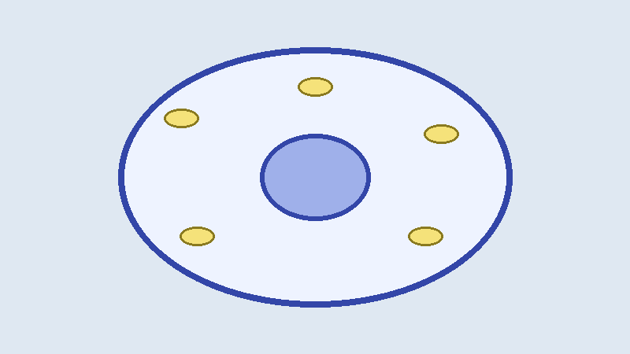

Every living thing is made of cells, and most of what a cell does happens in a few key parts.

## The parts

| Part | What it does |
| --- | --- |
| Nucleus | Holds the DNA |
| Mitochondria | Makes energy (ATP) |
| Ribosomes | Builds proteins |
| Cell membrane | Controls what gets in and out |

> Tip to self: draw the cell from memory before checking this table.

## Plant cells vs animal cells

Plant cells also have a cell wall, chloroplasts, and one big vacuole. Animal cells don't.

## Things I'm still unsure about

- How exactly does the membrane decide what to let through?
- Why do muscle cells have so many mitochondria?
